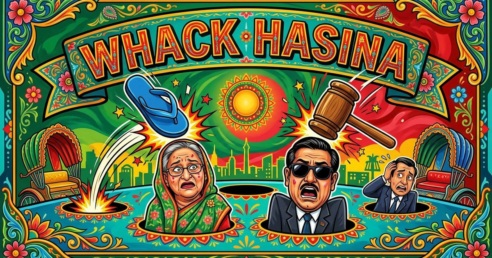

# Whack-Hasina: Arcade Ultimate Edition 🔨

> **Brutal Arcade Whack-a-Mole with Bengali Cultural Flavor, Boss Arenas, Armory, and Procedural Web Audio.**

🎮 **Live Play**: [https://mmht2000.github.io/Whack-Hasina/](https://mmht2000.github.io/Whack-Hasina/)

---

## 🌟 What's New in Ultimate Edition

### 🛠️ Bug Fixes & Architectural Overhaul
- **Zero ReferenceErrors**: Resolved critical crash (`goldenMolesHit is not defined`) during gameplay and daily challenge evaluation.
- **Zero Missing Audio 404s**: Integrated a self-contained **Web Audio API procedural sound engine** featuring 8-bit retro background music, combo chimes, golden mole fanfares, bomb explosions, and slipper slap sound effects (with `hit.mp3` fallback).
- **Precise Pointer & Touch Controls**: Fixed coordinate offsets and bounding box glitches. Responsive on desktop mice, touchpads, tablets, and smartphones.
- **No More Annoying Browser Prompts**: Replaced browser `prompt()` with a sleek in-game Game Setup modal with customizable difficulties (Easy, Medium, Brutal) and target scores.
- **Fixed Interval Leaks**: Centralized timer and loop management to ensure smooth performance across replays without memory leaks.

---

## 🚀 Game Features

### 1. 👥 Multi-Character Roster & Chaos Trio
Choose your target directly from the Game Setup modal or Custom Mole Studio:
- **👑 Sheikh Hasina** (`mole.png`) — The Supreme Leader.
- **🕶️ Obaidul Quader** (`Obaidul_Kader.png`) — Khela Hobe!
- **💻 Sajeeb Wazed Joy** (`Sajeeb_Wazed.png`) — Digital Prince.
- **🎲 Chaos Trio Mode**: Randomly alternates between all 3 characters during the match!

### 2. ⚔️ Game Modes
- **Quick Play (Objective Mode)**: Play for 30, 60, or 100 points, or test your stamina in **Endless Frenzy**.
- **👑 Boss Arena**: Select your Boss (Hasina, Quader, or Joy) and rapid-slam them against the clock with hilarious character-specific Bengali taunts!
- **Daily Bounty Quests**: Complete daily goals to earn coin rewards and prestige XP.

### 2. 🔨 Hammer Armory & Cosmetics
Unlock and equip unique weapons in the Shop:
- **Basic Mallet** (Default wooden mallet)
- **Golden Mallet** (+25% coin bonus per whack)
- **Cyber Mallet** (High-tech neon damage trail)
- **Thunder Mjolnir** (Heavy lightning slam sound & screen shake)
- **Justice Slipper / Chappal** (Hilarious Bengali cultural slap effect!)

### 3. ⚡ RPG Upgrades & Prestige
- **Mole Patience**: Increases the time moles remain visible.
- **Golden Luck**: Enhances spawn rate for rare Golden Moles.
- **Coin Greed**: Permanently boosts coins earned per whack.
- **Supreme Prestige**: Ascend at 1000 coins for permanent multiplier boosts.

### 4. 🎭 Custom Mole Studio
- Upload any picture of your choosing!
- Circular preview cropper automatically optimizes uploaded faces for the 3x3 whack grid.
- Persisted to browser storage so your custom mole is always ready.

---

## 🕹️ Controls
- **Mouse / Touch**: Tap or click moles, power-up orbs, and the Boss to whack.
- **Top Bar**: Fast access to volume toggles, Shop, and Main Menu navigation.
